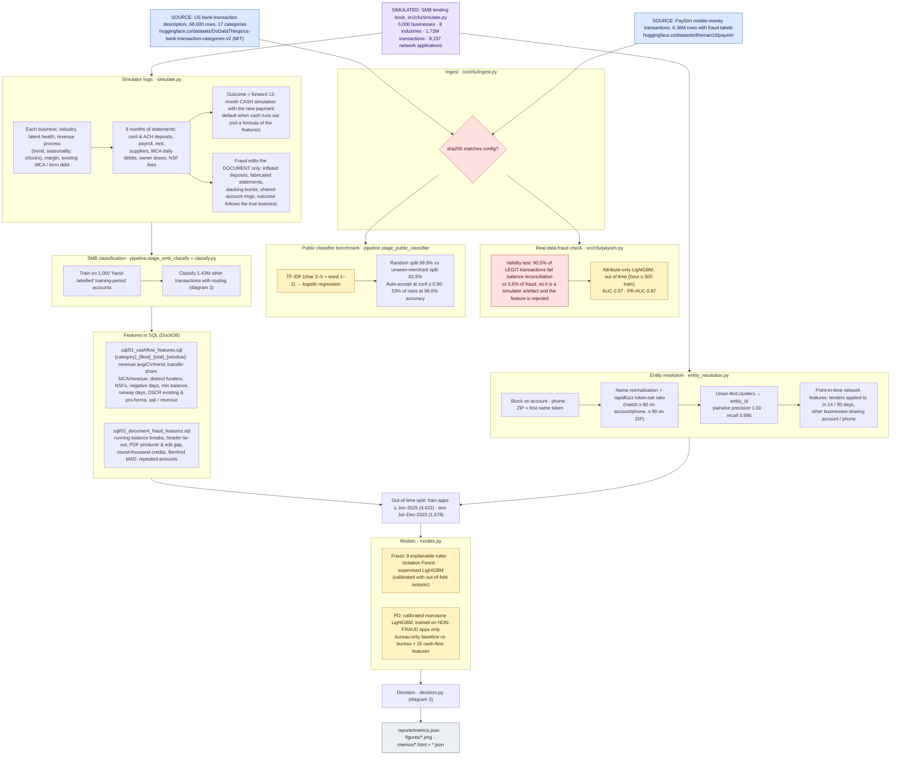
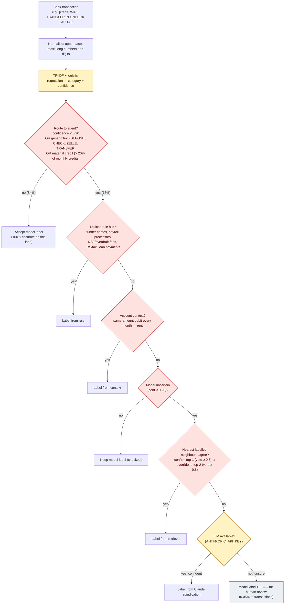
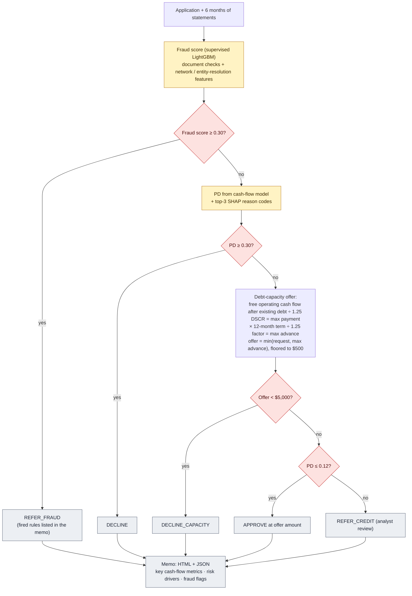
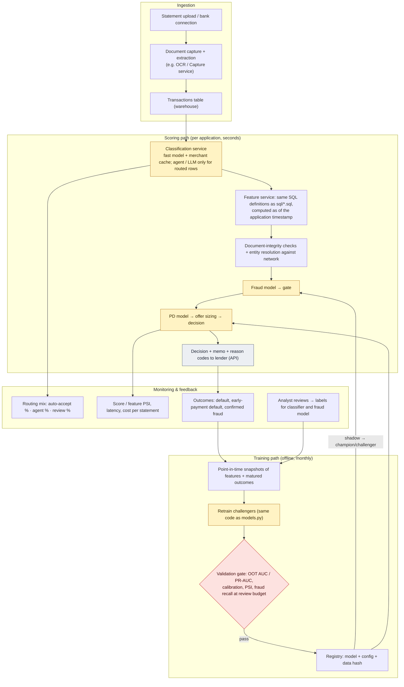

# How this project works

There are four diagrams:

1. **Pipeline:** every step, its source file, and the logic inside it.
2. **Transaction classification with agent routing:** how each bank transaction gets its category.
3. **Decision logic for one application:** fraud gate, then PD, then offer.
4. **Production design:** how this would run live. It is a proposed design, not implemented in this repo.

Colour key: **blue** = external data source · **purple** = simulated data · **lavender** = code step (file named in the box) · **yellow** = model · **red** = check or gate · **grey** = output

## 1. Pipeline (what `make all` runs)

## 2. Transaction classification with agent routing (classify.py)

Result on 1.43M SMB transactions: loan-proceeds recall goes from 66% to 100%, and accounts with more than 5% error in true revenue fall from 1.9% to 0.4%. A "round credit at a low balance means owner transfer" context rule was tested and removed because it misfired on honest round-dollar checks.

## 3. Decision logic for one application (decision.py)

Why fraud is a gate and not a PD feature: doctored statements make weak businesses look healthy. The credit model gives "inflated_sophisticated" fraud a 3.5% PD, but 52% of those applicants default. Fraud cases are excluded from PD training. Compared with no gate, the gate cuts fraud funded from 47 to 4 and the bad rate from 7.1% to 5.3%.

## 4. Production design (proposed; not implemented in this repo)

## How to run

| Step | Command | Time |
|---|---|---|
| Install | `pip install -r requirements.txt` | ~1 min |
| Everything | `make all` (or `PYTHONPATH=src python -m cfu.pipeline`) | ~10 min first run (simulates the book), ~6 min after |
| Tests | `make test` | seconds |
| Optional LLM step | set `ANTHROPIC_API_KEY` and `pip install anthropic` | — |
| Thresholds | edit `configs/config.yaml` (`decision:` block), rerun | — |
